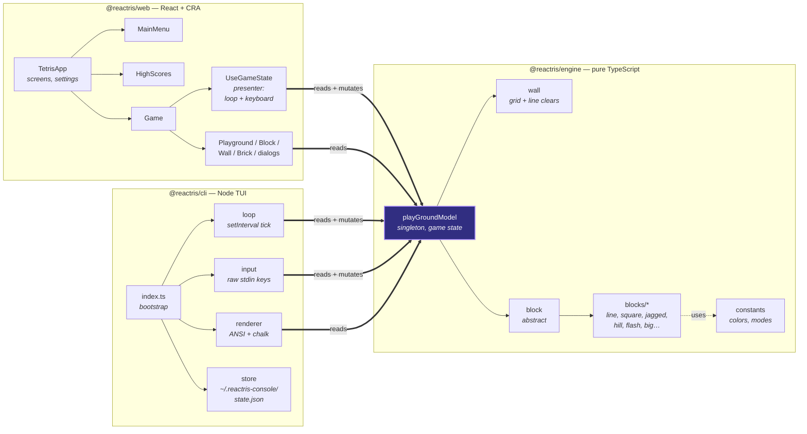

# Reactris - A React Tetris Experience

A Tetris clone built around a shared TypeScript game engine, with two front-ends in this repo:

- **Web** — React + TypeScript SPA (the original Reactris).
- **CLI** — a terminal/console version that drives the same engine and renders with ANSI color.

A future **WPF** front-end is planned as a third sibling, written in C# against the same engine API as a reference port.

The model is a full Tetris with several self-invented block shapes, and is easy to extend with your own pieces.

## Repository layout

```
reactris/
├── engine/    # @reactris/engine — pure TypeScript game model (no DOM, no React)
├── web/       # @reactris/web    — React app (CRA), imports the engine
├── cli/       # @reactris/cli    — Node TUI, imports the engine
├── package.json          # npm workspaces root
└── tsconfig.base.json    # shared compiler options
```

The engine is the single source of truth for game rules. Both front-ends consume it via the workspace package `@reactris/engine`.

## Setup

Install Node.js (18 or newer) and clone the repo. Then from the project root:

```bash
npm install                          # installs deps for all workspaces
npm -w @reactris/engine run build    # compile the engine to engine/dist
```

Building the engine once is required before running either front-end the first time (the React app and the CLI both resolve `@reactris/engine` to `engine/dist`). After that, `npm -w @reactris/engine run watch` will keep it rebuilding while you edit engine code.

## Running the web app

```bash
npm -w @reactris/web start
```

Opens a dev server on http://localhost:3000. The page reloads on edits and lint errors appear in the console. Built with CRA; for production:

```bash
npm -w @reactris/web run build       # outputs web/build/
```

Tests:

```bash
npm -w @reactris/web test -- --watchAll=false
```

The web app uses an MVP pattern: the model is the engine package, the View is the React components, and `web/src/components/UseGameState.tsx` is the Presenter that owns the game loop and keyboard.

## Running the CLI

```bash
npm -w @reactris/cli start           # ts-node, no build step needed
```

or build and run the compiled output:

```bash
npm -w @reactris/cli run build
node cli/dist/index.js
```

Use a real terminal (Windows Terminal, iTerm, etc.) — the renderer assumes ANSI 24-bit color and a window of roughly ≥30 rows × ≥50 columns.

### Controls

| Key             | Action                |
|-----------------|-----------------------|
| ← / A           | Move left             |
| → / D           | Move right            |
| ↓ / S           | Soft drop             |
| ↑ / Q           | Rotate counter-clockwise |
| E               | Rotate clockwise      |
| Esc             | Pause / unpause       |
| R               | Restart after game over |
| Ctrl+C          | Quit                  |

### State and high scores

The CLI persists settings and per-game-type high scores to:

```
~/.reactris-console/state.json
```

(`C:\Users\<you>\.reactris-console\state.json` on Windows.) There is no in-CLI settings screen yet — to change rows/columns/game type, edit that JSON file. The web app uses `localStorage` and does not share its store with the CLI.

## Architecture



Engine API the front-ends rely on:

- `playGroundModel.getInstance(cols, rows, gameType, wallHeight, wallProb, levelDiv)` — singleton game state.
- `pg.reset()`, `pg.incTime()`, `pg.updateGame()`, `pg.checkBlockPosition()`.
- `pg.activeBlock.{moveLeft, moveRight, turnLeft, turnRight, getBrickPosition, blockIndex}`.
- Reads of `pg.{wall, getWall(), numRows, numColumns, score, level, gameover, pause, nextActive}`.

This contract is what a future WPF (or any other) front-end would re-implement.

## Backlog

A list of bugs and missing features:
[View backlog](https://github.com/users/pertan4711/projects/3/views/1).

## Additional

- A sandboxed clone of the (pre-monorepo) code lives in [CodeSandbox](https://codesandbox.io/s/reactris-ng769y?file=/src/index.tsx).
- A `Dockerfile` is present at the repo root from the single-package days; it expects to build and run inside `web/` after the restructure and needs an update before it works again.
