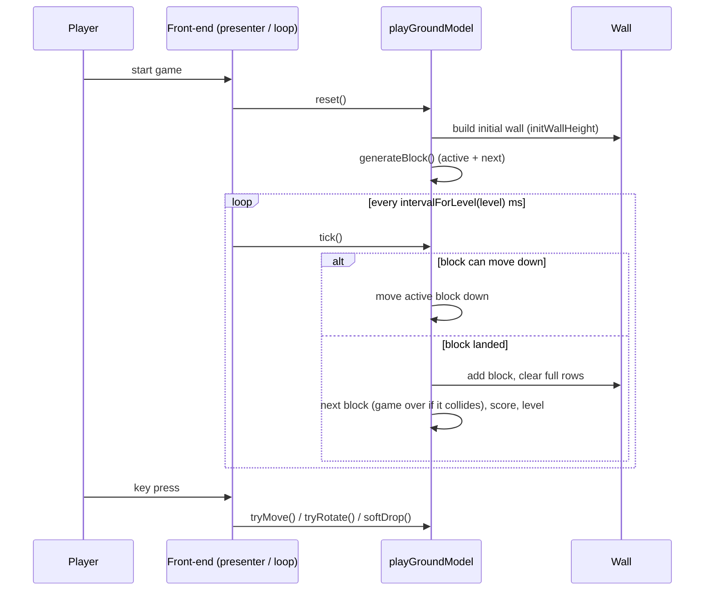

See also: [CI/CD with GitHub Actions](ci.md)

# UML diagrams

A popular UML diagram tool is PlantUML. The `uml/` folder has a simple domain model (`domain_model.puml`) and a sequence diagram (`start_game.puml`) that illustrate the structure of the game engine (`engine/src`).

### Installation

Use the PlantUML extension in VS Code or Notepad++. You also need a Java runtime, and in some cases Graphviz:

```
sudo apt update
sudo apt install default-jre
sudo apt install graphviz
```

On Windows: `winget install EclipseAdoptium.Temurin.21.JRE` and `winget install Graphviz.Graphviz`.

Documentation:

- <https://plantuml.com/>
- <https://crashedmind.github.io/PlantUMLHitchhikersGuide/>

# Mermaid diagrams

Mermaid is another popular tool. Its syntax is similar to PlantUML, but it can be used directly in Markdown files such as this one.

GitHub renders Mermaid out of the box. To preview it in VS Code, install the "Markdown Preview Mermaid Support" extension.

The sequence below shows how a front-end (web or CLI) drives the engine's `playGroundModel`:



The architecture overview of all packages is in the [main README](../README.md#architecture).
