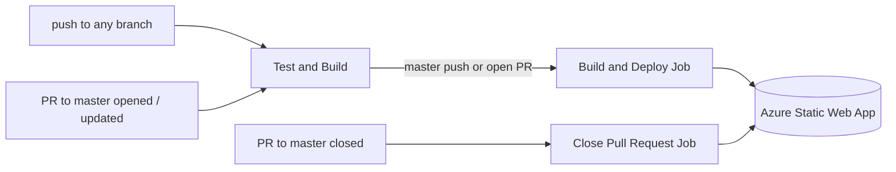

# CI/CD with GitHub Actions

Reactris uses one GitHub Actions workflow that tests and builds every push, and deploys the web app to
Azure Static Web Apps from `master` and from pull requests.

Workflow file: [`.github/workflows/azure-static-web-apps-ambitious-beach-0e3f98303.yml`](../.github/workflows/azure-static-web-apps-ambitious-beach-0e3f98303.yml)
(the name was generated by Azure when the Static Web App was created).

Runs: <https://github.com/pertan4711/reactris/actions>

## Overview



| Job | Runs when | Does |
|---|---|---|
| `test_and_build` | Every push, and PRs to `master` | `npm ci`, `npm test`, build engine + web, type-check CLI, upload the built site |
| `build_and_deploy_job` | After `test_and_build` passes, on a push to `master` or an open PR | Uploads the built site to Azure (a preview environment for PRs) |
| `close_pull_request_job` | A PR to `master` is closed | Removes that PR's preview environment on Azure |

A push to a feature branch therefore only runs **Test and Build**; both Azure jobs show as *skipped*.

## How a workflow is set up

Every `.yml` file in `.github/workflows/` is a *workflow*. GitHub picks them up automatically.

```
workflow  (one .yml file)
 ├─ on:     WHEN it runs (triggers)
 └─ jobs:   WHAT runs, each on its own fresh virtual machine
     └─ steps:  commands or ready-made actions, run in order
```

### Triggers: `on:`

```yaml
on:
  push:
    branches: ["**"]          # any push, to any branch
  pull_request:
    types: [opened, synchronize, reopened, closed]
    branches: [master]        # PRs that target master
```

Other useful triggers: `workflow_dispatch:` (a "Run workflow" button in the UI), `schedule:` (cron),
`release:`.

### Jobs, `needs:` and `if:`

Each job starts on a fresh, empty machine (`runs-on: ubuntu-latest`). Nothing carries over between
jobs unless it is passed on explicitly (see artifacts below).

- `needs: test_and_build` makes a job wait for that job and skips it if it failed. This is what keeps
  broken code from being deployed.
- `if:` decides whether a job runs at all. The deploy job only runs for `master` pushes and open PRs:

  ```yaml
  if: (github.event_name == 'push' && github.ref == 'refs/heads/master') || (github.event_name == 'pull_request' && github.event.action != 'closed')
  ```

### Steps

A step either runs a shell command (`run:`) or uses a ready-made action (`uses:`):

```yaml
- uses: actions/checkout@v4      # clone the repo onto the machine
- uses: actions/setup-node@v4    # install Node 20
  with:
    node-version: 20
    cache: npm                   # reuse downloaded packages between runs
- name: Test
  run: npm test                  # plain shell command
```

`uses: owner/repo@version` refers to an action published in a GitHub repo (`actions/*` are GitHub's
own); `with:` passes inputs to it. If a step exits with a non-zero code, the job stops and fails.

### Artifacts: passing files between jobs

The built site is handed from the test job to the deploy job:

```yaml
# in test_and_build
- uses: actions/upload-artifact@v4
  with:
    name: web-build
    path: web/build

# in build_and_deploy_job
- uses: actions/download-artifact@v4
  with:
    name: web-build
    path: web-build
```

Artifacts can also be downloaded from the run page and are kept for 7 days (`retention-days`).

The deploy step uses `skip_app_build: true` and `app_location: "web-build"`, so Azure uploads the
finished files instead of trying to build the monorepo itself.

### Secrets

```yaml
azure_static_web_apps_api_token: ${{ secrets.AZURE_STATIC_WEB_APPS_API_TOKEN_AMBITIOUS_BEACH_0E3F98303 }}
```

`${{ ... }}` is an expression. `secrets.X` reads a value stored under
**repo Settings → Secrets and variables → Actions**; it is masked as `***` in logs.
`secrets.GITHUB_TOKEN` is created automatically for every run.

## Checking runs

- **Browser:** the repo's **Actions** tab lists every run. Open a run, then a job, and expand a step to
  see its log. A ✅ / ❌ next to a commit on the repo page links to its run.
- **GitHub CLI:** install with `winget install GitHub.cli`, log in with `gh auth login`, then:

  ```
  gh run list                 # recent runs
  gh run watch                # follow the current run live
  gh run view --log-failed    # logs of the failed steps only
  ```

- **VS Code:** the *GitHub Actions* extension shows runs and logs in the sidebar.
- **Email:** GitHub notifies you when a workflow you triggered fails
  (Settings → Notifications → Actions).

## Running the CI steps locally

The same checks the **Test and Build** job runs:

```bash
npm ci                                  # clean install from the root lockfile
npm test                                # engine tests (Jest)
CI=true npm run build                   # CI=true makes CRA treat lint warnings as errors
npx tsc --noEmit -p cli/tsconfig.json   # type-check the CLI
```

`npm ci` deletes and reinstalls `node_modules`. Stop a running dev server (`npm run web`) first, or
restart it afterwards; otherwise it keeps serving a build with missing modules.

## Troubleshooting

- **Build fails on a lint warning:** CRA fails the build on warnings when `CI=true`. Run
  `CI=true npm run build` locally to see it, and fix the warning.
- **`npm ci` fails:** `package-lock.json` at the repo root is out of sync with a `package.json`. Run
  `npm install` locally and commit the updated lockfile. Workspaces only use the root lockfile.
- **Deploy step fails but Test and Build passes:** the problem is on the Azure side. Read the log of
  the *Build And Deploy* step. A message about an invalid or missing deployment token means a new
  token has to be fetched from the Static Web App in the Azure portal (*Manage deployment token*) and
  stored in the `AZURE_STATIC_WEB_APPS_API_TOKEN_AMBITIOUS_BEACH_0E3F98303` secret.

## Tips

- **Trying out workflow changes:** edit the YAML on a branch and push. The run uses that branch's
  version of the file, so `master` is unaffected.
- **Require CI before merging:** Settings → Branches → add a rule for `master` →
  *Require status checks to pass* → select **Test and Build**.
- **Manual run button:** add `workflow_dispatch:` under `on:`.
- **Reference:** <https://docs.github.com/actions>, especially the *Workflow syntax* page.
